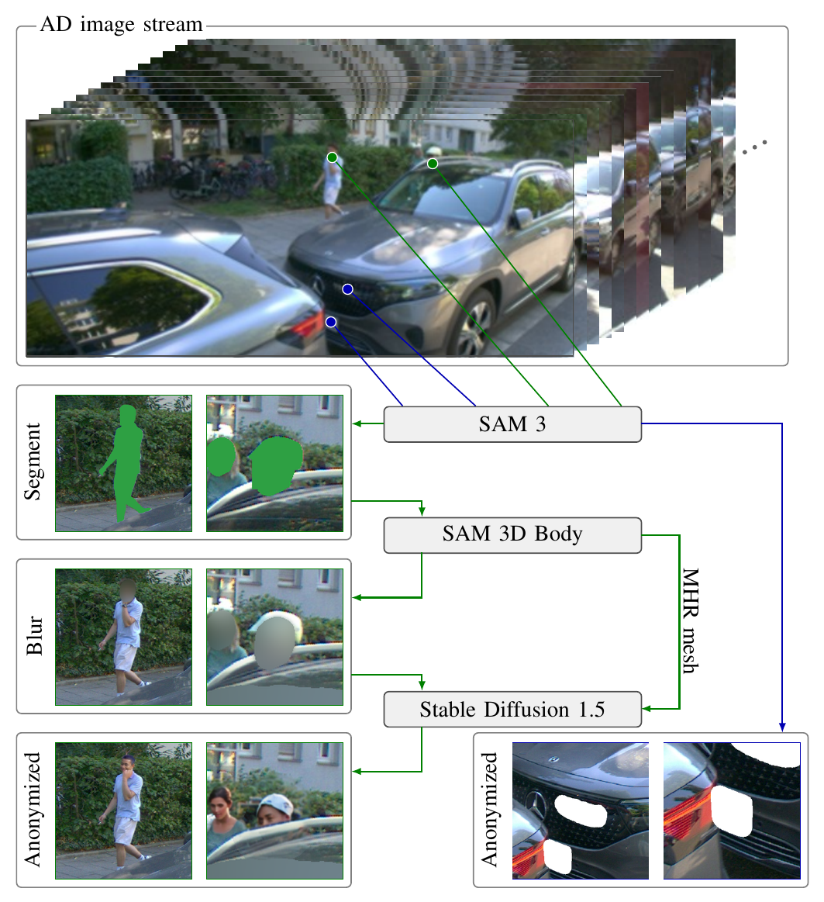
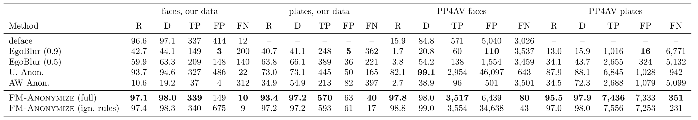
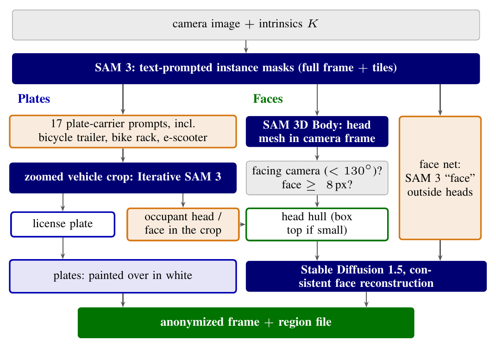
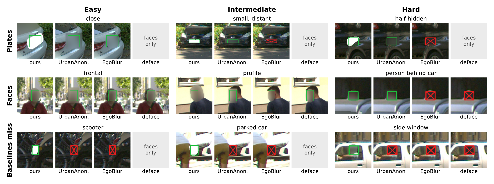
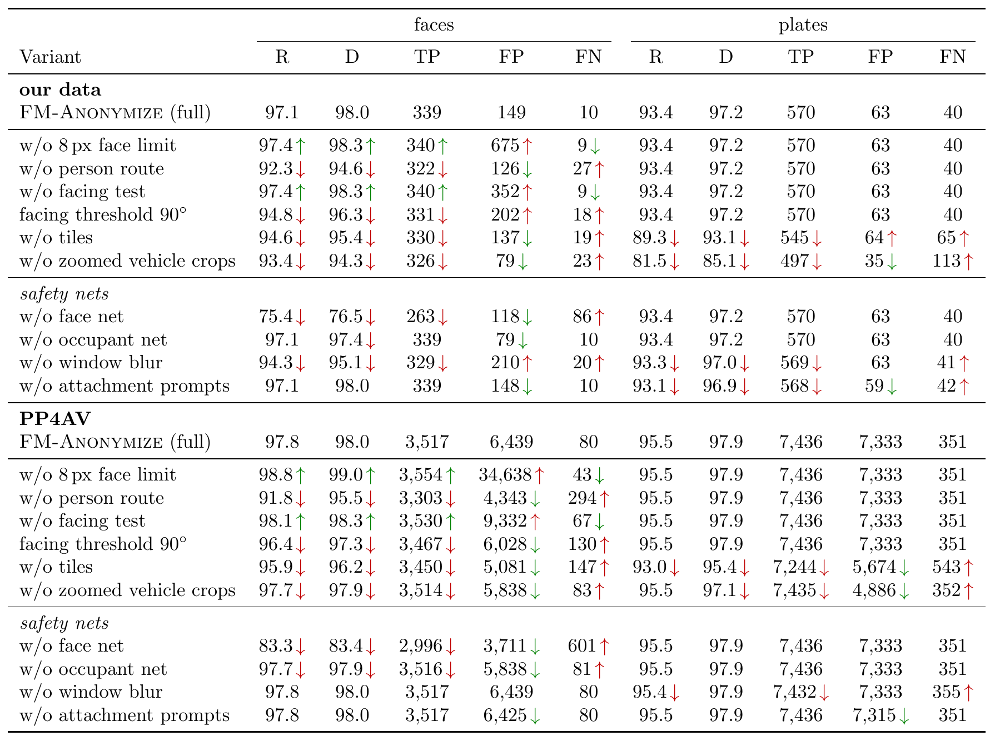
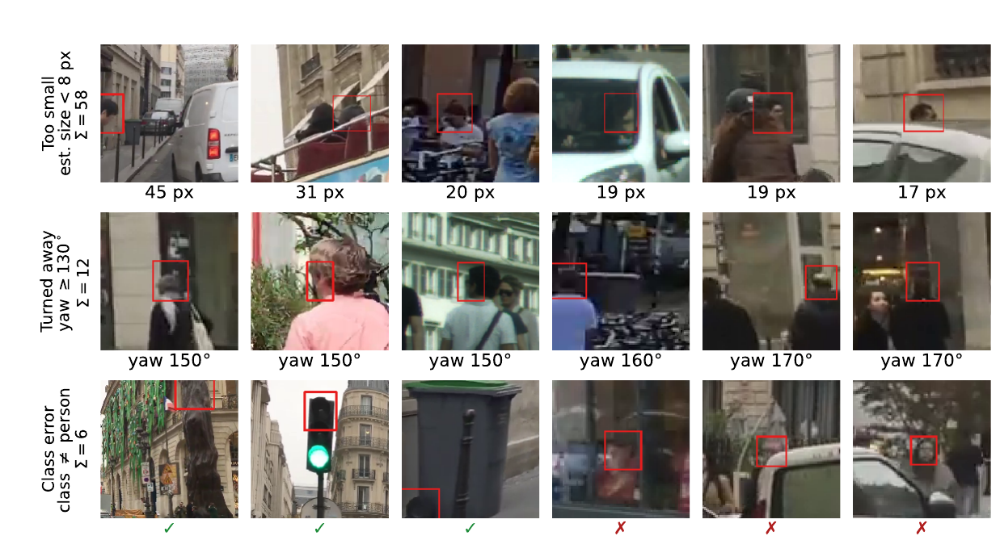
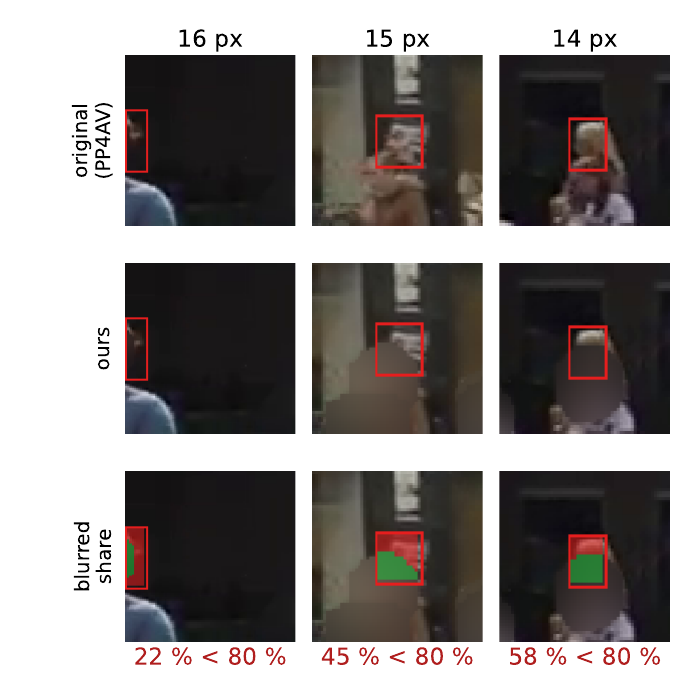
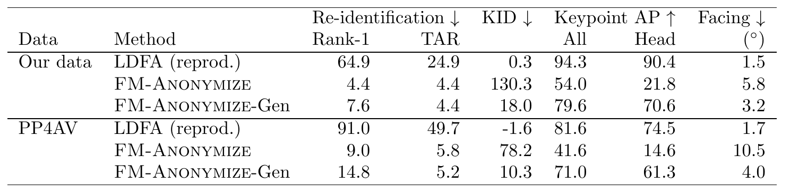
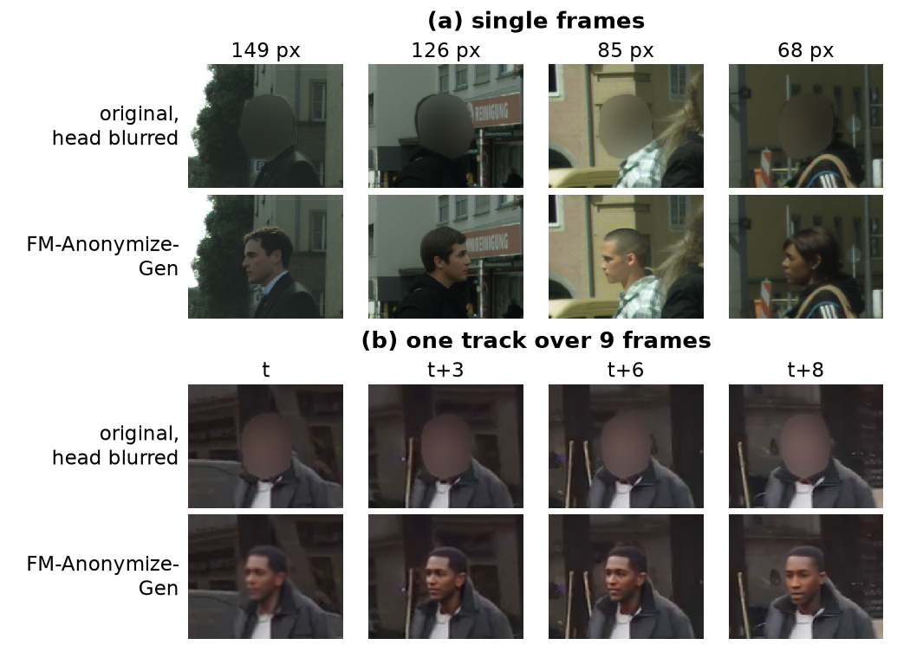

# FM-Anonymize

<p align="center"></p>

Training-free anonymization of driving data with promptable segmentation
and 3D human mesh recovery. SAM 3 finds every plate carrier and person
and searches zoomed vehicle crops for plates and occupants; SAM 3D Body
lifts each person to a mesh, and a head that faces the camera
(< 130 deg, estimated face >= 8 px) is anonymized in its projected
shape. A SAM 3 `face` net, the occupant search, a window blur and five
attachment prompts (bicycle trailer, bike trailer, bike rack, caravan,
tractor) are the safety nets. Plates are filled white, faces are
blurred. Nothing is trained; everything runs on premises.

**FM-Anonymize-Gen** replaces the blurred heads by synthetic faces:
Stable Diffusion 1.5 inpaints each head, guided by depth and keypoint
ControlNets from the SAM 3D Body fit, with a synthetic identity shared
along a track ([Generation](#generation-fm-anonymize-gen)).

## Start

```bash
uv run app.py          # opens http://127.0.0.1:5050
```

Only [uv](https://docs.astral.sh/uv/) is needed: `app.py` declares its
one dependency (Flask) inline, so it neither installs PyTorch nor needs
the submodules. The page checks this checkout for every setup step
below, shows the command for each missing one, and lists the commands
of a run.

## Setup for your own runs

One NVIDIA GPU with 24 GB (CUDA 12.6 wheels; developed on an
RTX 4090), Linux, Python 3.12 (uv fetches it).

```bash
git submodule update --init           # third_party/sam3, third_party/sam-3d-body
uv sync                               # torch 2.7 + cu126, SAM 3, Flask
```

The SAM 3 and SAM 3D Body weights are gated on Hugging Face: request
access to [facebook/sam3](https://huggingface.co/facebook/sam3) and
[facebook/sam-3d-body-dinov3](https://huggingface.co/facebook/sam-3d-body-dinov3),
then

```bash
uv run hf auth login
uv run hf download facebook/sam3 --local-dir checkpoints/sam3
uv run hf download facebook/sam-3d-body-dinov3 --local-dir checkpoints/sam-3d-body
```

[PP4AV](https://huggingface.co/datasets/khaclinh/pp4av) for the
benchmark:

```bash
uv run hf download khaclinh/pp4av --repo-type dataset \
    --include "data/*.zip" --local-dir datasets/pp4av-zip
unzip -q datasets/pp4av-zip/data/images.zip -d datasets/pp4av/data
unzip -q datasets/pp4av-zip/data/annotations.zip -d datasets/pp4av/data
```

Finally link everything into `resources/` (paths in
[`config-global.json`](config-global.json); edit them if your data or
checkpoints live elsewhere):

```bash
python3 blur_data/scripts/dm_link.py
```

## Run

**PP4AV (paper, Table I).** Detection writes one region file (JSON,
RLE masks) per image; scoring and rendering read them, so the GPU step
runs once:

```bash
uv run python blur_data/scripts/blur-data-anonymize.py \
    --config configs/anonymize.yaml --dataset pp4av --run pp4av-ours
# PP4AV boxes enclose the whole head, our face regions only the face:
# grow them by 1/0.735 (as CenterFace does)
uv run python blur_data/scripts/blur-data-derive-run.py \
    --src pp4av-ours --dst pp4av-ours-grow --grow-faces 1.3605
uv run python blur_data/scripts/blur-data-paper-eval.py \
    --gt pp4av --runs ours=pp4av-ours-grow --out outputs/eval/pp4av.json
```

Privacy recall R: a box counts as protected when >= 80 % of it is
anonymized. The ablations are the configs in
[`configs/ablations/`](configs/ablations) (same command, other
`--config`). `blur_data/scripts/blur-data-baseline.py` runs deface,
EgoBlur, UrbanAnonymizer and the Autoware anonymizer on the same images
(installed by hand into `third_party/`, see its docstring), and
`blur-data-gt-confusion.py` scores any set of runs.

**Your own recordings.** The reader `--dataset v2b` expects a
nuScenes-style export (`<scene>/v1.0-*/` tables plus `sensor_data/`),
linked as `resources/data/v2b`; `blur-data-render.py` writes the
anonymized images into a copy (`resources/data/v2b-blurred`):

```bash
uv run python blur_data/scripts/blur-data-anonymize.py \
    --config configs/anonymize.yaml --run my-run
uv run python blur_data/scripts/blur-data-render.py --run my-run
```

**Any image folder: the app.**

```bash
uv run python -m blur_data.web        # http://127.0.0.1:5010
```

- **Anonymize a new folder**: pick it, read the analysis (images,
  layout, resolution, estimated time), check the output folder, Start;
  progress shows the latest image as a before | after slider. The
  output folder gets `regions/`, `anonymized/` (same relative paths),
  `summary.jsonl`, `config.json` and `DONE`; a stopped run resumes.
- **Open a project**: overview (counts, size and score histograms) and
  an image grid with a viewer (`s` before | after slider, `v` regions,
  `z` full resolution, `d` persons not anonymized and why).
- **Compare** 2 or 3 runs on the same images (e.g. FM-Anonymize against
  a baseline), sorted by their largest disagreement.

The app listens on 127.0.0.1 only: it shows original frames.

## Results

**Table I.** Quantitative results on our data and PP4AV: privacy recall
R, detected recall D, TP, FP and FN. Bold: best per column.



**Pipeline.** SAM 3 segments plate carriers and persons; vehicle crops
are searched for plates and occupants; facing heads come from the body
mesh. Safety nets in orange.

<p align="center"></p>

**Qualitative comparison** on plates, faces and objects the baselines
miss, from easy to hard. Green box: protected; dark, red-crossed box:
missed (original pixels of our data are not shown).



**Table II.** Ablation on our data and PP4AV; arrows against the full
method (green: better, red: worse).



**Misses on PP4AV.** The false negatives of FM-Anonymize: estimated
face size, yaw and class errors (left), and how much of the head box is
anonymized when a facing head is missed (right).

<table><tr>
<td width="64%"></td>
<td width="36%"></td>
</tr></table>

**Table III.** Generative replacement compared with blur and an LDFA
reproduction: re-identification (ArcFace rank-1, TAR at 0.1 % FAR),
head realism (KID x 1000), keypoint AP against predictions on the
original images, and the change of the head direction.



**FM-Anonymize-Gen on PP4AV**: (a) heads at different sizes and
orientations, blurred in the original and generated; (b) four
observations from a nine-frame track with a shared synthetic identity
reference.



## Generation (FM-Anonymize-Gen)

Replaces the heads of an FM-Anonymize run by synthetic ones; every
other region keeps its blur or fill. Per head, a 512 x 512 crop is cut
from the image *as FM-Anonymize blurs it*, and SD 1.5 inpainting
regenerates the whole head region (SDEdit, strength 0.8), guided by a
depth ControlNet (a template head placed at the SAM 3D Body head pose)
and an OpenPose ControlNet (the person's own face and shoulder
keypoints), with a synthetic identity (IP-Adapter-FaceID on a reference
face painted from a seed) that all heads of one track share. The result
is blended back and matched in blur, noise and JPEG level. The module
docstring of
[`blur_data/generate/__init__.py`](blur_data/generate/__init__.py)
walks through the steps; every setting is in
[`configs/generate.yaml`](configs/generate.yaml).

**Setup.** About 4 s per head on an RTX 4090 (the diffusion pipelines
run with CPU offload next to SAM 3D Body):

```bash
uv sync --group inpaint --group attack
```

The diffusion weights come from Hugging Face on first use, each pinned
to a revision in the config: SD 1.5 inpainting (CreativeML
OpenRAIL-M), ControlNet v1.1 depth and OpenPose, IP-Adapter-FaceID
plus-v2 and its CLIP image encoder (non-commercial research only).
FaceID embeds the synthetic references with InsightFace `buffalo_l`
(`det_10g.onnx`, `w600k_r50.onnx`; non-commercial research only), put
into `checkpoints/arcface/` and linked by `dm_link.py`.

**Generate** on PP4AV (heads are linked into tracks on their own
regions, with boxes grown 2x as the search region):

```bash
uv run --group inpaint python blur_data/scripts/blur-data-generate.py \
    --regions-run pp4av-ours --dataset pp4av --run gen-pp4av \
    --config configs/generate-pp4av.yaml --track-scale 2.0 \
    [--keys <json list of keys>]
```

On your own recordings use `--dataset v2b`; `--window 4 8` also links
the heads of 4 frames before and 8 after, so a person keeps one
identity across frames, and `--seq <tracks.json>` renders whole tracks
(`{"tracks": [[key, ...], ...]}`). Writes
`outputs/<run>/images/<key>.<ext>`, `config.json`, `summary.jsonl` and
`DONE`. Seeds are derived from the frame keys and tracks, so a run is
reproducible; an interrupted run resumes.

**Evaluate (Table III).** `--mode blur` writes FM-Anonymize's blur of
the same frames and `--mode reencode` the re-encoded original (no
GPU); the metrics are separate scripts:

```bash
G=blur_data/scripts/blur-data-generate.py
uv run python $G --mode blur --regions-run pp4av-ours --dataset pp4av --run blur-pp4av
uv run python $G --mode reencode --regions-run pp4av-ours --dataset pp4av --run reencode-pp4av
# re-identification: ArcFace rank-1 and TAR at 0.1 % FAR
uv run --group attack python blur_data/scripts/blur-data-attack.py --dataset pp4av \
    --rendered blur=blur-pp4av --rendered gen=gen-pp4av --no-plates \
    --out outputs/eval/gen-attack-pp4av.json
# keypoint AP against a detector's predictions on the originals
uv run python blur_data/scripts/blur-data-utility.py --dataset pp4av \
    --version reencode=reencode-pp4av --version blur=blur-pp4av \
    --version gen=gen-pp4av --out outputs/eval/gen-utility-pp4av.json
# head pose kept? SAM 3D Body on the original and on each version
uv run --group inpaint python blur_data/scripts/blur-data-pose-error.py \
    --dataset pp4av --regions-run pp4av-ours --version blur=blur-pp4av \
    --version gen=gen-pp4av --out outputs/eval/gen-pose-pp4av.json
# head realism: KID x 1000 of head crops against the originals
uv run python blur_data/scripts/blur-data-realism.py --dataset pp4av \
    --regions-run pp4av-ours --version blur=blur-pp4av \
    --version gen=gen-pp4av --out outputs/eval/gen-realism-pp4av.json
# one identity along a track (ArcFace cosine between consecutive frames)
uv run --group attack python blur_data/scripts/blur-data-temporal.py \
    --dataset pp4av --tracks <tracks.json> --version gen=gen-seq \
    --out outputs/eval/gen-temporal.json
```

## Layout

```
app.py                  start page (uv run app.py)
templates/              its page
blur_data/
  anonymize/            pipeline: config, regions, head geometry, blur
  models/               SAM 3, SAM 3D Body, diffusion and face models
  data/                 readers: nuScenes-style export (v2b), PP4AV
  baselines/            deface, EgoBlur, UrbanAnonymizer, Autoware
  generate/             FM-Anonymize-Gen
  metrics/              privacy recall, confusion, re-id, utility, realism
  web/                  the app (python -m blur_data.web)
  scripts/              command-line entry points (above)
configs/                anonymize.yaml, ablations/, generate*.yaml
tests/                  pytest
third_party/            SAM 3, SAM 3D Body (git submodules)
```

## Verify

```bash
uv run ruff check .
uv run mypy
uv run pytest
```

## Licences

The SAM 3 and SAM 3D Body code and weights come under their own
licences (see the submodules and the Hugging Face model cards). PP4AV
is CC BY-NC-ND 4.0 and is not redistributed here. The diffusion and face models of FM-Anonymize-Gen
are for non-commercial research only (see above).
